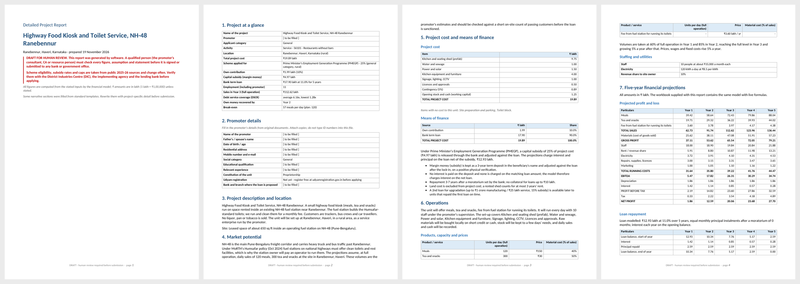
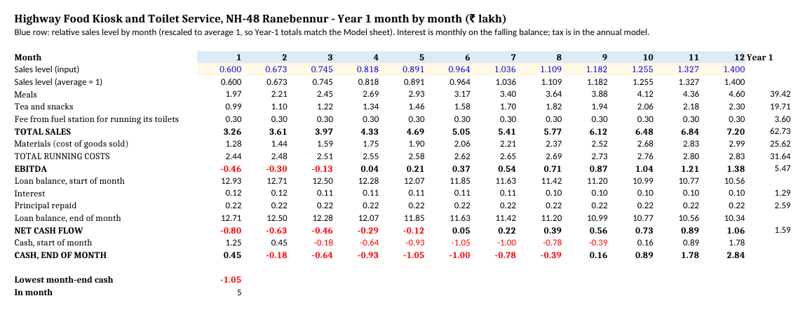
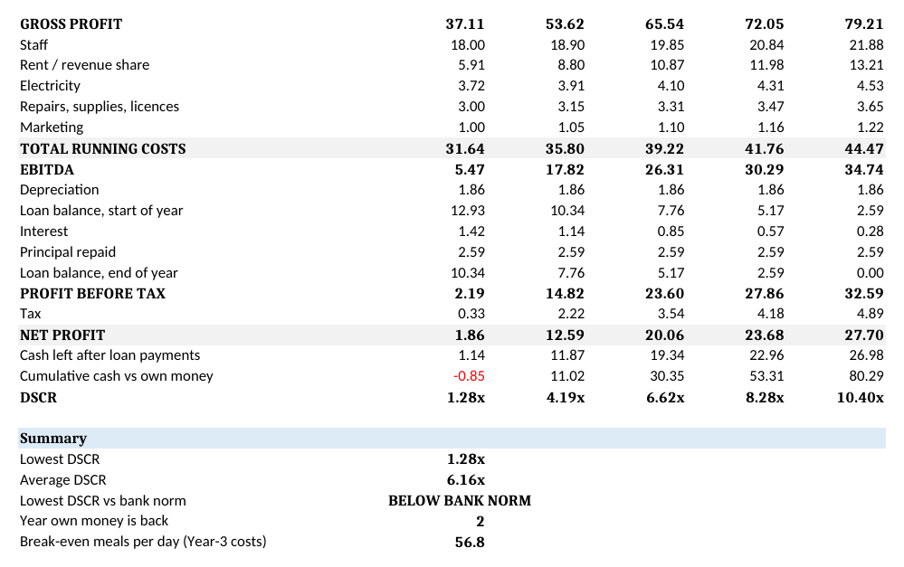

# scheme-dpr

Turn a small-business idea in Karnataka into a **bank-ready government-scheme application pack**:

1. **Scheme match:** PMEGP, PMFME, Karnataka CMEGP, SMAM, Karnataka Tourism (wayside amenities), Mudra and CGTMSE, each checked rule by rule. The output gives subsidy %, cap, own contribution, the source of every rule, and a "verify with DIC / bank" flag.
2. **5-year financial model (.xlsx):** live formulas with blue inputs, covering sales, costs, EBITDA, loan schedule, DSCR, break-even, payback and a Year-1 month-by-month cash budget. LibreOffice recalculates it headless, and the tool checks it cell by cell against an independent Python model.
3. **Detailed Project Report (.docx + .md):** in the usual PMEGP / bank section order, with promoter placeholders, a documents checklist and a declaration.

> **A human must review every report before it is submitted.** As of 18 Nov 2026, PMEGP is awaiting approval to continue past 31 Mar 2026 and PMFME has lapsed. The tool flags both.
> The tool drafts and cross-checks. It does not replace the consultant, CA or resource person who signs off. Scheme terms change often; confirm them with the District Industries Centre (DIC), the implementing agency and the bank.

**Who it is for:** district consultants, CAs and PMFME / PMEGP resource persons who write these reports by hand today, usually from a stale Excel template and a Word file.



## What it caught on the first real case

The test case is a ₹19.89 lakh highway food kiosk that had already been worked out by hand in a spreadsheet. The tool reproduces that spreadsheet to the paisa, and then finds three things the spreadsheet did not show:

1. **Year-1 cash runs out.** Sales build up over the first months, but staff, the site owner's revenue share and loan payments start in month 1. Month-end cash goes negative in month 2 and stays negative through month 8, at worst −₹1.05 lakh. The annual view only shows a Year-1 DSCR of 1.28x. The report tells the applicant to ask for a cash-credit or overdraft limit before opening.

   

2. **The cushion is thin where it matters.** Break-even is 57 meals a day against a plan of 120, which looks safe. But if volumes come in 10% lower, Year-1 DSCR falls to 0.68x; at 20% lower it goes negative. The driver is fixed staff cost (₹18 lakh a year for 10 people), not the loan.
3. **The scheme it depends on is in limbo.** PMEGP fits on every rule, but its approved period ended on 31 Mar 2026 and continuation had not been approved as of Nov 2026. PMFME lapsed on 30 Sep 2026. The Karnataka scheme people still cite (CMEGP) is reported discontinued. The tool shows scheme status as the first check, not a footnote.



---

## Quick start

```bash
pip install -e ".[dev]"          # Python 3.11+: pyyaml, pydantic, openpyxl, anthropic
npm install -g docx              # for the .docx report
# LibreOffice for recalculation: brew install --cask libreoffice  (or set SOFFICE=/path/to/soffice)

python -m scheme_dpr run example.yaml            # narrative by Claude if ANTHROPIC_API_KEY is set
python -m scheme_dpr run example.yaml --no-llm   # fully offline; template narrative
```

Outputs land in `out/`:

| File | What it is |
|---|---|
| `*_model.xlsx` | Inputs / Model / Schemes / Read me sheets, live formulas, recalculated |
| `*_DPR.docx`, `*_DPR.md` | The project report |
| `*_schemes.json` | Machine-readable scheme check (every rule, status, source, as-of date) |

Other commands:

```bash
python -m scheme_dpr schemes example.yaml        # eligibility only
python -m scheme_dpr draft --idea "..." --district Dharwad --area urban --category women \
    --items "pulveriser 4.5L, packing machine 2.2L" --volumes "60 kg/day at ₹320" -o draft.yaml
python -m scheme_dpr validate-rules              # structure + provenance of schemes.yaml
python -m scheme_dpr i18n-missing kn             # strings still to translate into Kannada
```

## Worked example: highway food kiosk, NH-48 Ranebennur

`example.yaml` is the "Option A" case from a hand-built feasibility workbook: a food kiosk run on space rented inside a fuel station, which also runs the station's toilets for a fee. Haveri district, rural, general category. The tool reproduces that workbook **exactly** (`tests/test_finance.py` checks all 26 lines × 5 years to 1e-9):

| | |
|---|---|
| Project cost | ₹19.89 lakh (PMEGP service cap ₹20 lakh) |
| Scheme selected | PMEGP, 25% (rural, general) = ₹4.97 lakh; own contribution 10% = ₹1.99 lakh |
| Bank loan | ₹17.90 lakh sanctioned; ₹12.93 lakh carries interest after the subsidy |
| Year-3 sales / EBITDA | ₹112.62 / ₹26.31 lakh |
| DSCR | Y1 **1.28x** (below the 1.3x norm, so the report flags it), then 4.19x to 10.40x |
| Payback / break-even | Own money back in Year 2; 57 meals a day against a plan of 120 |
| Year 1 month by month | Cash goes **negative from month 2 to month 8** while sales ramp up, lowest −₹1.05 lakh in month 5. The annual model hides this; the report asks for a cash-credit limit or more opening cash |

Ruled out, with reasons: PMFME (food service is not food processing; the scheme also lapsed on 30 Sep 2026), CMEGP (reported discontinued since FY 2020-21; ₹10 lakh cap), SMAM (not farm machinery), the Tourism wayside subsidy (minimum eligible cost ₹2 crore) and Mudra (a ₹17.9 lakh loan needs Tarun Plus, which needs a repaid Tarun loan). Open points flagged: **PMEGP itself is awaiting continuation**, since its approved period ended 31 Mar 2026 and no approval had been found as of 18 Nov 2026; applicant age and education; Udyam registration; and the words "liquor" and "tobacco" in the idea text.

`examples/` has two more illustrative cases: a woman-led spice unit and an SC-category tailoring unit (special-category rates, 5% own contribution). The spice unit would get more from PMFME (35%) than PMEGP (25%), but the tool picks PMEGP because PMFME has lapsed. A live scheme always ranks above one awaiting continuation, and both rank above a lapsed one.

---

## How it works

```
project.yaml ──► models.py (pydantic: validates every input)
                    │
                    ├─► finance.py ─────────── 5-year model in Python (source of truth for the report)
                    │
                    ├─► eligibility.py ◄────── data/schemes.yaml (versioned rules + source + as-of)
                    │      pass 1: choose capital-subsidy scheme (largest subsidy, non-combinable)
                    │      pass 2: loan / guarantee schemes against the resulting loan
                    │
                    ├─► excel.py ── openpyxl formulas ─► LibreOffice headless recalc
                    │                 └─► scan for #REF!/#DIV/0!… + compare every cell with finance.py
                    │
                    ├─► narrative.py ── Claude writes prose only, from a facts JSON;
                    │                   any figure not in the facts → section replaced by template
                    │
                    └─► report.py ── block list ─► Markdown
                                                └─► render/build_docx.js (Node "docx") ─► .docx
```

Design rules the code enforces:

* **Numbers are computed in code, never by the model.** Claude gets pre-formatted facts and writes the description, market, operations and business-risk sections. `check_numbers` rejects any section containing a figure that is not in the facts. Ratio risks (DSCR below norm, break-even cushion, revenue concentration) are written by code.
* **Scheme terms live only in `scheme_dpr/data/schemes.yaml`.** Each scheme has a `status` (active / pending_continuation / lapsed / unverified / discontinued) with its own source. Each rule has `source`, `as_of` and `confidence` (`confirmed` / `single_source` / `unconfirmed`). Status is always the first check: a discontinued scheme fails, and a pending or lapsed one shows as *Verify* and ranks below live schemes. An unconfirmed rule can never return a clean pass. A test fails if subsidy rates or caps appear in `eligibility.py`, and another shows that editing the YAML changes the result.
* **Two independent implementations of the model.** The workbook formulas and `finance.py` are written separately and must agree after LibreOffice recalculates. That check caught a real moratorium bug during development.
* **Unknown is not pass.** Missing age, education or Udyam status shows as *Verify*. One-per-family and EDP training show as *Applicant to declare*.
* **Text is separate from code.** All user-facing strings are in `scheme_dpr/locales/en.yaml`; `kn.yaml` falls back to English key by key, so Kannada can be added a string at a time.

### Model conventions

Money in ₹ lakh, prices in ₹. Volume factor: Y1 = ramp1, Y2 = ramp2, Y3 = 1, then +growth a year. Prices, wages and fixed costs rise with inflation. The interest-bearing loan is cost − own − subsidy, because PMEGP charges no interest on the subsidy portion. Principal is repaid in equal monthly instalments after an optional moratorium, and interest each year is charged on the opening balance (slightly conservative). Depreciation is straight-line on fixed assets. DSCR = (EBITDA − tax) ÷ (interest + principal). Break-even = units per day of the main product needed at Year-3 prices to cover running costs and debt service, after the other income lines.

### Input file

See `example.yaml`; every field is documented in `scheme_dpr/models.py`. Main blocks: `activity` (sector + tags the rules match on, e.g. `food_processing`, `wayside_amenity`), `location`, `applicant` (categories, age, education, Udyam, prior Mudra), `setup_cost`, `revenue` (per-day volume × price, or fixed annual), `costs`, `finance` (`scheme: auto | <id> | none`, rate, tenor, moratorium), `assumptions`.

## Tests

```bash
python -m pytest -q        # 118 tests; LibreOffice and Node tests skip if the tools are missing
```

* `test_finance.py`: every line of the worked example, moratorium splits, subsidy caps, zero-loan and loss years, input validation.
* `test_eligibility.py`: scheme status (each state, ranking, discontinued never selected), PMEGP rate table (general/special × rural/urban, special-area districts), caps by sector, working-capital share, negative list, age and education, CMEGP age and caps by category, PMFME vs PMEGP selection including the ₹10 lakh cap, Tourism minimum cost / +5% / Bengaluru exclusion, SMAM CHC rate, Mudra tiers, Udyam as a to-do, forced and "none" scheme, rules-file validation.
* `test_outputs.py`: workbook formulas and blue inputs; recalculated workbook equals the Python model (with and without moratorium); DPR section order; .docx content; the narrative number guard; fallback when Claude is unavailable; Kannada fallback; CLI.

## Limits (v1, stated plainly)

* **Scheme data needs a human owner.** Rules file v2026.11.2 was re-checked against official texts on 18 Nov 2026. These were confirmed: the PMEGP guidelines of 07.12.2023, the PIB release on PMFME, the Karnataka Tourism Policy 2024-29 book, the SMAM guidelines of Dec 2025, the Mudra gazette of Oct 2024, and the CGTMSE ₹10 crore ceiling. Two **status** facts are the weak point. PMEGP's continuation after 31 Mar 2026 rests on one news report of a Rajya Sabha reply plus no approval found; PMFME's lapse after 30 Sep 2026 rests on a secondary source. CMEGP's discontinuation is from a secondary site (the official portal was unreachable). CGTMSE coverage bands, PMFME's ODOP rule for new units, and what counts as a "wayside amenity" remain unconfirmed.
* **The Claude path is tested with fakes, not live.** The narrative and `draft` calls use the official `anthropic` SDK (`claude-opus-5-5`, structured JSON output, server-side refusal fallback), but this repo's tests never hit the API. Without credentials the tool uses template text and says so in the report.
* Annual model for Years 1-5 with a monthly view of Year 1 only (monthly interest; no monthly tax), simple tax rate, single proprietorship, Karnataka only, one capital subsidy per project.
* Kannada: the framework is in place; only a couple of strings are translated, and they need native review.

## What would make it a product (not just a tool)

1. **Five real reports with real consultants.** Sit with two DIC-empanelled consultants or PMFME resource persons in Haveri / Dharwad, run their last few cases through it, and measure time saved and what the bank or DIC sent back. That is the only validation that matters.
2. **A named owner for `schemes.yaml`**, with a monthly check of the PMEGP / PMFME portals and Karnataka circulars, and a changelog. Stale scheme terms are the main way this tool can hurt someone.
3. **Bank-format extras**: assets schedule and WDV tax depreciation, a full CMA data format. (A Year-1 monthly cash budget is already in.) (A sensitivity table for volume, price and cost shocks is already in section 7.)
4. **Kannada output** reviewed by a native speaker who knows DIC terminology.
5. A simple web form in front of the YAML for consultants who don't edit files.
